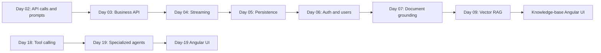
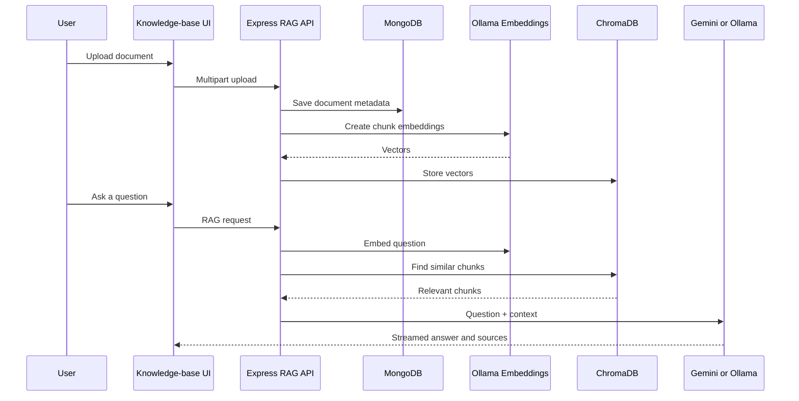
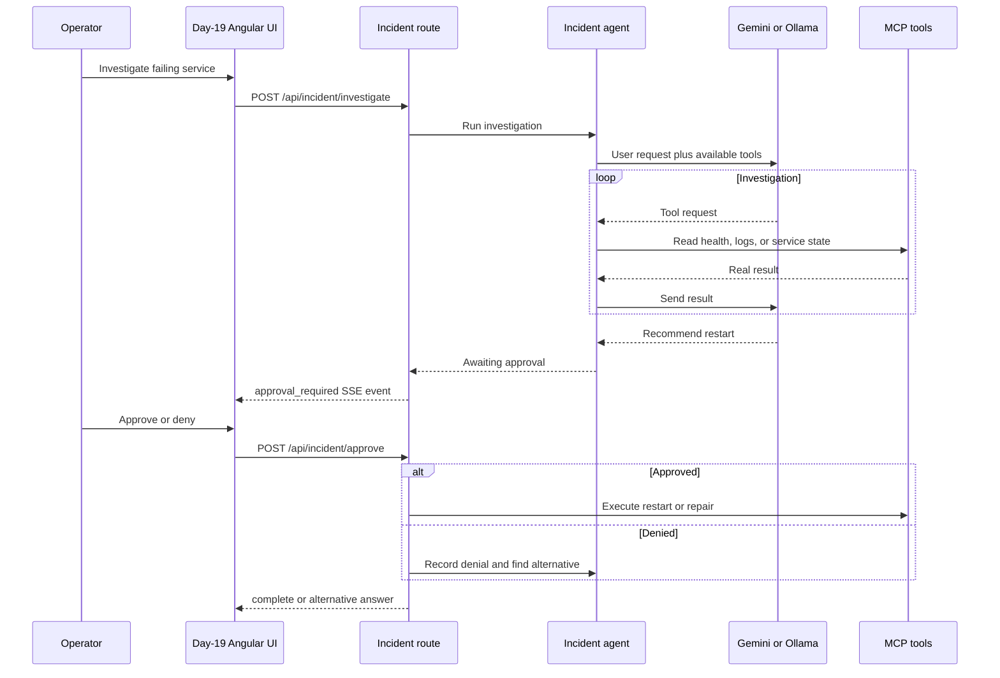
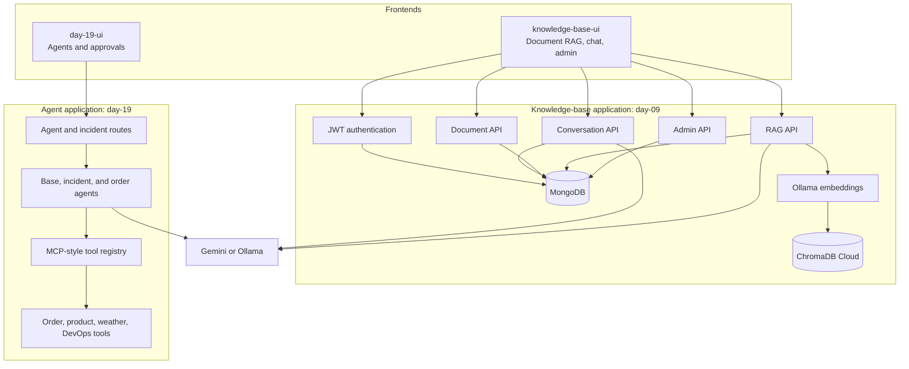
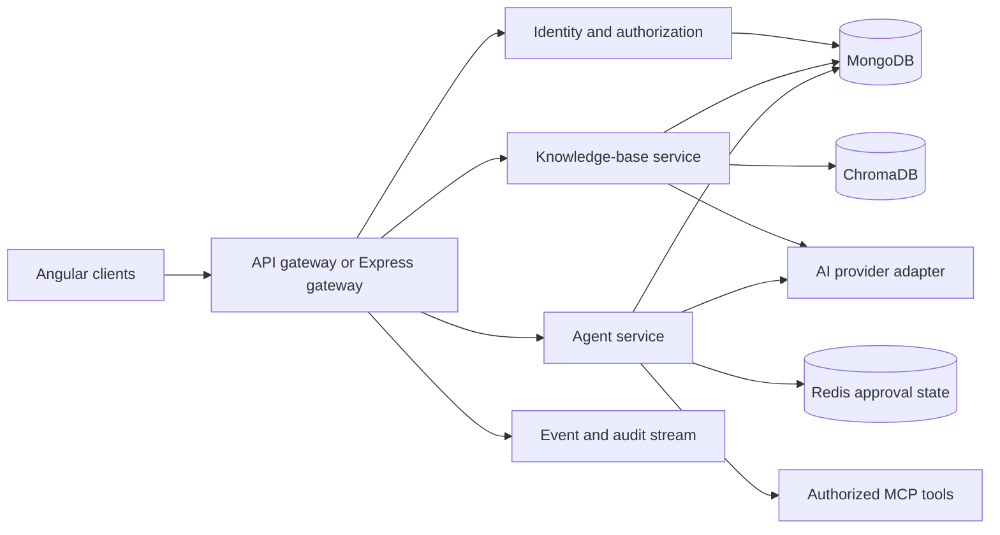

# Agentic AI Learning Workspace: Complete Project Explanation

## 1. Executive Summary

This workspace is an Agentic AI learning and implementation curriculum built in stages. It contains independent Node.js/Express exercises rather than one continuously integrated monorepo. Each `day-*` folder represents a new level of capability.

There are three main outcomes:

1. **AI API fundamentals**: cloud and local model calls, prompt engineering, structured output, and streaming.
2. **A complete AI knowledge-base application**: authentication, MongoDB, document upload, RAG search, usage tracking, administration, and an Angular UI.
3. **Tool-using and approval-aware agents**: a model decides when to call registered tools, and sensitive actions may wait for human approval.

The most complete applications are:

- **Knowledge-base application:** `day-09` plus `knowledge-base-ui`
- **Agent application:** `day-19` plus `day-19-ui`
- **Earlier learning checkpoints:** `day-02` through `day-07`
- **Tool-calling checkpoint:** `day-18`

## 2. Is This One Project?

Not exactly. These folders are independent learning stages with overlapping code.

They should be understood as a progression:



The folders do not share one root package, Docker setup, or common workspace configuration. Code is copied and enhanced between stages. Therefore, running the newest folder does not automatically include earlier folders.

## 3. Project Evolution from Scratch

### Stage 1: Calling AI Models

**Folder:** `day-02`

The project begins as standalone JavaScript scripts. `gemini-test.js` calls Google Gemini, while `ollama-test.js` calls a locally running Ollama server. `prompt-builder.js` combines a system role, constraints, and a user request.

The first question answered is:

> How can application code ask an AI model for a response?

Communication is direct:

```text
JavaScript script -> AI provider API -> text response
```

### Stage 2: Converting AI into a Business API

**Folder:** `day-03`

Express is introduced. The application exposes HTTP endpoints for ticket analysis. Prompts instruct the model to return JSON containing fields such as sentiment, category, and urgency.

The application adds:

- Request validation
- Rate limiting
- Structured provider abstraction
- Bulk processing
- Provider health checking
- Consistent error responses

Communication becomes:

```text
Client -> Express route -> validation -> AI service -> Gemini or Ollama -> parsed JSON
```

### Stage 3: Streaming Responses

**Folder:** `day-04`

The application changes from returning only a final response to sending Server-Sent Events. The browser receives response chunks before generation is complete.

Communication:

```text
Browser -> POST request -> Express -> AI provider stream -> SSE chunks -> browser UI
```

This improves perceived responsiveness, which is important for chat interfaces.

### Stage 4: Persistent Conversations

**Folder:** `day-05`

MongoDB is introduced. Conversation, message, and AI usage data are stored separately.

Core workflow:

1. Create a conversation.
2. Save the user's message.
3. Load recent message history.
4. Send history and the new question to the AI provider.
5. Stream the answer.
6. Save the assistant response.
7. Record token usage, latency, provider, and estimated cost.

Communication:

```text
Client -> chat route -> conversation service -> MongoDB
                                      -> AI service -> Gemini or Ollama
                                      <- response chunks
Client <- SSE stream
```

### Stage 5: Authentication and Administration

**Folder:** `day-06`

The application becomes multi-user and production-oriented:

- User registration and login
- bcrypt password hashing
- JWT authentication
- User roles
- Daily token limits
- Protected chat routes
- Admin usage and user APIs
- Authentication, rate-limit, and error middleware

Communication:

```text
Client -> bearer token -> authentication middleware -> authorized route
                                                       -> MongoDB or AI service
```

The bearer token identifies the user. The server uses that identity for ownership, token budgets, and admin authorization.

### Stage 6: Document-Aware Answers

**Folder:** `day-07`

The application gains document upload and document-grounded question answering.

Workflow:

1. An authenticated user uploads a PDF or text file.
2. Multer validates and stores the file.
3. `pdf-parse` or a text reader extracts the content.
4. MongoDB stores document ownership and metadata.
5. The application loads relevant document text.
6. The text is placed into an AI prompt.
7. Gemini or Ollama generates a streamed answer.

Communication:

```text
Upload -> Multer -> text extraction -> MongoDB
Question -> document service -> document text -> AI prompt -> streamed answer
```

This is document-grounded behavior, but it does not yet provide large-scale semantic retrieval.

### Stage 7: Vector RAG

**Folder:** `day-09`

Large documents are processed for Retrieval-Augmented Generation.

Complete RAG workflow:

1. Extract document text.
2. Split text into smaller chunks.
3. Generate embeddings with Ollama's `nomic-embed-text` model.
4. Store vectors and IDs in ChromaDB Cloud.
5. Store document and chunk metadata in MongoDB.
6. Embed a user's question.
7. Use semantic similarity to find relevant chunks.
8. Send the question and relevant chunks to Gemini or Ollama.
9. Stream the answer and return source information.

Communication:



This folder contains the most complete knowledge-base backend.

### Stage 8: The Knowledge-base Frontend

**Folder:** `knowledge-base-ui`

This Angular 18 application provides a browser interface for the `day-09` backend.

Features:

- Login and registration
- JWT route guards
- Automatic bearer-token insertion
- Dashboard and usage information
- Conversation list and chat
- Document upload and indexing
- RAG search and answer streaming
- Administration screens
- Global loading and error handling

Its main frontend flow is:

```text
Angular component -> feature service -> ApiService/auth interceptor -> Day-09 API
                                                                    -> response
Angular component <- service observable or SSE events
```

### Stage 9: Tool-Using AI

**Folder:** `day-18`

The architecture changes from a model that only generates text to a model that can perform actions through tools.

Available tool groups include:

- Order status and customer orders
- Product search and stock
- Weather lookup
- A foundational DevOps tool registry

The AI loop is:

```text
User message
  -> model receives available tool declarations
  -> model requests a tool
  -> server executes the tool
  -> result is returned to model
  -> model requests another tool or gives a final answer
```

This gives the model access to real data and prevents answers based on unsupported guesses.

### Stage 10: Specialized Agents and Human Approval

**Folders:** `day-19` and `day-19-ui`

Day-19 adds specialized roles and a control boundary for sensitive operations.

It contains:

- `BaseAgent`: provider loop, tool selection, and approval-state handling
- `IncidentAgent`: service health and operational investigation
- `OrderAgent`: order and product questions
- MCP-style tool registry
- DevOps tools
- Human approval endpoints
- An Angular interface with chat, incident, and order screens

Example incident workflow:



This is the highest level of the workspace's agent progression.

## 4. Overall Technical Architecture



## 5. Main Technologies

| Area | Technology |
|---|---|
| Backend | Node.js, Express.js, ES modules |
| AI providers | Google Gemini, Ollama |
| Database | MongoDB, Mongoose |
| Vector search | ChromaDB Cloud |
| Embeddings | Ollama `nomic-embed-text` |
| Authentication | JWT, bcryptjs |
| Uploads | multer |
| PDF parsing | pdf-parse |
| Streaming | HTTP Server-Sent Events |
| Frontends | Angular 18, RxJS |
| UI libraries | Bootstrap, Angular Material, PrimeNG |
| Real-time UI transport | Native browser Fetch for SSE |
| Tool interface | MCP-style local function registry |

## 6. Strengths Already Implemented

- The workspace demonstrates clear AI capability progression.
- Cloud and local providers are both supported.
- Streaming is implemented consistently.
- MongoDB persistence includes conversations, documents, chunks, users, and usage.
- Authentication and role checks exist in the knowledge-base application.
- RAG separates metadata, embeddings, and vector search responsibilities.
- Tool calls are resolved through a central registry and executor.
- The agent architecture supports specialized agents.
- Sensitive operations use approval checkpoints.
- Angular frontends provide actual browser interfaces rather than only API demos.
- SSE status events expose tool and provider activity to users.

## 7. Incomplete or Missing Areas

### 7.1 No unified monorepo integration

The folders duplicate models and services instead of sharing a package or source module.

**Risk:** Changes in `day-09` are not reused by `day-19`, and bugs may be fixed independently in several copies.

**Improvement:** Convert the final product into a root monorepo or move stable code into shared packages.

### 7.2 Missing environment setup

There are no confirmed `.env.example` files across all stages. A user must inspect source and documentation to discover required variables.

**Improvement:** Add `.env.example` files and a root setup guide with API key, MongoDB, Ollama, ChromaDB, JWT, CORS, and upload settings.

### 7.3 Two separate UI applications use port 3000 for APIs

Both frontends are configured for `http://localhost:3000/api`, but they expect different backends:

- `knowledge-base-ui` expects `day-09`
- `day-19-ui` expects `day-19`

**Risk:** They cannot run against both backends simultaneously on the same port without conflict.

**Improvement:** Use different API ports, for example 3000 for knowledge base and 3001 for agents, or deploy both APIs behind one gateway and use environment-specific URLs.

### 7.4 Approval state is in memory

Day-19 stores pending approvals in a JavaScript `Map`.

**Risk:** Restarting the server loses approvals, and multiple server instances cannot share approval state.

**Improvement:** Store approval sessions in MongoDB or Redis with expiration and an audit record.

### 7.5 Agent tool execution needs stronger authorization

The approval workflow is demonstrated in the agent route, but tool access should be enforced centrally and consistently.

**Improvement:** Add per-tool permissions, argument validation, allowlists, idempotency keys, and a command audit trail.

### 7.6 RAG document security needs verification

Document IDs should always be checked against the current user before search or answer operations.

**Improvement:** Centralize document and chunk ownership checks for every RAG route, not just list and upload routes.

### 7.7 RAG is not fully reproducible

Chunk size, overlap, embedding model, top-K, reranking, and source citation rules should be explicitly configured and tested.

**Improvement:** Create RAG configuration values and evaluation datasets covering recall, citation accuracy, hallucination, and answer relevance.

### 7.8 Missing tests

The Angular projects contain generated test files, but the workspace does not show a complete integration-test suite across Express, MongoDB, ChromaDB, models, tools, and approvals.

**Improvement:** Add unit tests, API tests, ChromaDB test containers or mocks, E2E UI tests, and provider adapters with mock responses.

### 7.9 Provider abstraction is duplicated

Gemini and Ollama loops are implemented separately in every stage.

**Improvement:** Create one provider interface with `chat`, `stream`, `embed`, and `function-call` capabilities. Adapters should be interchangeable by configuration.

### 7.10 Observability is incomplete

There is console logging, but no structured request tracing, metrics, or centralized audit log.

**Improvement:** Add correlation IDs, structured logs, request latency metrics, token metrics, tool-call metrics, trace spans, and alerts.

### 7.11 Secrets and production configuration

Provider keys and JWT secrets are environment values, but deployment, secret rotation, TLS, HTTPS, and key-vault practices are not yet unified.

**Improvement:** Never commit real secrets. Use secret managers or environment injection and rotate credentials regularly.

### 7.12 Conversation history and context need limits

Day-05 uses a recent-message count, and other stages pass in conversation history. Context windows may still grow or exceed provider limits.

**Improvement:** Add token-aware history trimming, summaries, long-term memory, and conversation retention policies.

### 7.13 Production deployment is missing

The workspace has development scripts but no confirmed Docker, Compose, CI/CD, reverse proxy, or Kubernetes setup.

**Improvement:** Add container definitions and automated build/test/deployment pipelines.

### 7.14 Tool idempotency and retry handling

Tool calls can be retried, and some actions may execute twice if upstream requests are repeated.

**Improvement:** Use idempotency keys and retry policies, especially for cancellations, restarts, refunds, and other state-changing tools.

### 7.15 Human approval UX can be improved

Approval state can expire in 30 minutes, but the UI should clearly show session status, requester, target resource, impact, and audit information.

**Improvement:** Persist approvals, include audit metadata, and automatically expire stale requests.

## 8. Recommended Final Architecture

A practical final project should have these boundaries:



Recommended final services:

1. **Identity service**
2. **Knowledge-base/RAG service**
3. **Conversation service**
4. **Agent service**
5. **Tool gateway**
6. **Approval service**
7. **Audit and usage service**
8. **Angular portal**

## 9. Priority Improvement Sequence

### Priority 1: Stabilize

- Add `.env.example`
- Separate ports for both backends
- Add database seeds and setup scripts
- Document exact startup order
- Consolidate provider configuration

### Priority 2: Secure

- Apply consistent authorization to RAG and documents
- Move approvals out of memory
- Validate every tool argument
- Restrict sensitive tools
- Add audit records

### Priority 3: Verify

- Add API and provider mock tests
- Add RAG quality evaluation
- Add UI E2E tests
- Add approval and rollback tests

### Priority 4: Operate

- Add structured logs and metrics
- Add Docker/Compose
- Add CI/CD
- Add health readiness checks
- Add secret and deployment management

### Priority 5: Consolidate

- Merge useful stages into a single maintained product
- Remove duplicated code
- Preserve each stage as documentation or a branch
- Publish a single architecture and API contract

## 10. Suggested Repository Structure

```text
agentic-ai-workspace/
├── apps/
│   ├── knowledge-base-api/
│   ├── agent-api/
│   └── angular-portal/
├── packages/
│   ├── ai-provider/
│   ├── auth/
│   ├── rag/
│   ├── mcp-tools/
│   └── shared-types/
├── infrastructure/
│   ├── docker/
│   └── deployments/
├── docs/
│   ├── architecture.md
│   ├── api.md
│   └── rag-evaluation.md
├── tests/
│   ├── api/
│   ├── rag/
│   └── e2e/
└── learning-stages/
    ├── day-02/
    ├── day-03/
    └── ...
```

## 11. Final Assessment

The workspace already demonstrates a realistic AI engineering learning path from API calls to a knowledge-base RAG platform and approval-aware agents.

It has two nearly complete applications:

- **Knowledge-base RAG application:** suitable for private document search and enterprise chat.
- **Tool-and-agent application:** suitable for support, order, and operational assistance.

However, they are currently separate stage-based projects, not a fully unified production system. The next major step is not adding more isolated days. It is consolidating the mature `day-09` and `day-19` implementations, standardizing configuration and provider abstractions, securing tool and document access, persisting approval state, and adding tests and deployment automation.
