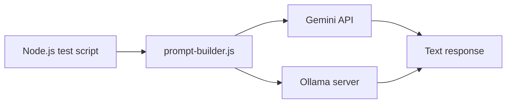

# Day-02 Folder Summary

## Concept
Day-02 introduces direct interaction with AI models through code. It demonstrates both a cloud model (Google Gemini) and a local model (Ollama), and shows how a prompt builder separates a system role, constraints, and the user's question.

## Real-world example
A company may need to generate summaries or explanations automatically. The team can send prompts to a cloud provider for speed or use a local model for privacy-sensitive documents. A prompt builder keeps responses consistent across applications and can be reused by many features.

## Architecture

**Components:**
- `gemini-test.js`: Calls the Gemini SDK using an API key.
- `ollama-test.js`: Calls a locally running Ollama server over HTTP.
- `prompt-builder.js`: Builds structured prompts with roles and constraints.
- `package.json`: Defines JavaScript dependencies.

**Communication:** A script creates a prompt, sends it to the selected provider, and prints the returned text. Gemini requires internet access and an API key; Ollama communicates with `localhost:11434` and keeps data on the local machine.
