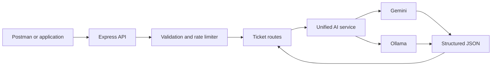

# Day-03 Folder Summary

## Concept
Day-03 turns free-form AI responses into a structured business API. Customer support tickets are analyzed into fields such as sentiment, category, and urgency. It also introduces validation and rate limiting so the service is protected and predictable.

## Real-world example
A support platform can automatically classify thousands of incoming complaints. Urgent technical problems can be routed to engineering, refund requests to billing, and positive feedback to a customer-success team. Bulk analysis helps teams prioritize their queue.

## Architecture

**Components:**
- `src/app.js`: Starts Express and mounts routes.
- `src/routes/ticket.routes.js`: Defines single-ticket and bulk-analysis endpoints.
- `src/middleware/`: Validates input, limits request volume, and handles errors.
- `src/prompts/ticket.prompts.js`: Defines the AI role and required JSON format.
- `src/services/`: Abstracts provider-specific calls and JSON parsing.

**Communication:** The client sends ticket text through middleware to the route handler. The AI service adds the prompt and calls Gemini or Ollama. The response is parsed into JSON and returned to the client.
