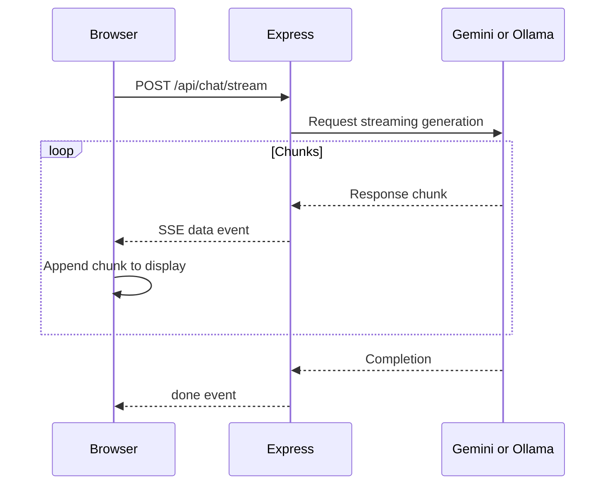

# Day-04 Folder Summary

## Concept
Day-04 demonstrates real-time AI response streaming. Instead of waiting for the entire answer, the browser receives small pieces immediately using Server-Sent Events (SSE).

## Real-world example
Chat assistants, coding tools, and help desks feel more responsive when text appears as it is generated. Streaming also lets users begin reading while a long answer is still being produced.

## Architecture

**Components:**
- `src/public/test-client.html`: Browser UI and SSE reader.
- `src/routes/chat.routes.js`: Opens an SSE response and validates messages.
- `src/services/ai.stream.js`: Selects the configured provider.
- `src/services/gemini.stream.js`: Streams Gemini output.
- `src/services/ollama.stream.js`: Streams Ollama NDJSON output.

**Communication:** The browser sends HTTP POST data, the Express route keeps the connection open, provider chunks are transformed into SSE events, and the browser appends each chunk to the response area.
