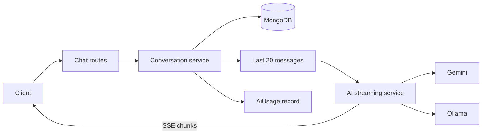

# Day-05 Folder Summary

## Concept
Day-05 adds persistent conversation state to streamed AI chat. Users can create conversations, retrieve message history, receive context-aware answers, and view AI usage information. MongoDB records conversations, messages, and provider usage.

## Real-world example
A customer support chatbot must remember earlier questions in the same session. It also needs usage records for cost control, operational reporting, and summarizing long discussions.

## Architecture

**Components:**
- `src/models/conversation.model.js`: Conversation metadata, summary, and counters.
- `src/models/message.model.js`: Stored user and assistant messages.
- `src/models/aiUsage.model.js`: Tokens, provider, cost, and latency records.
- `src/services/conversation.service.js`: Loads history and persists messages and summaries.
- `src/services/ai.stream.js`: Streams the AI provider response.
- `src/routes/chat.routes.js`: Exposes conversation, stream, usage, and summary endpoints.

**Communication:** The route verifies the conversation and user, saves the user message, loads recent history, streams the answer, saves the assistant message, and records usage. Messages in a conversation therefore provide context for later requests.
