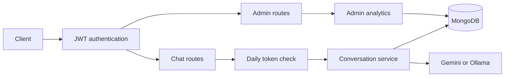

# Day-06 Folder Summary

## Concept
Day-06 adds enterprise identity and security controls to the AI chat platform. Users register and log in, receive JWT credentials, receive roles, and operate within configurable token budgets. Administrators can monitor users and usage.

## Real-world example
A company can offer an internal AI assistant to employees without every employee sharing an account. It can restrict high-cost features to administrators and stop a user who has exhausted a daily allowance.

## Architecture

**Components:**
- `src/middleware/auth.middleware.js`: Verifies JWTs and checks active users and roles.
- `src/models/user.model.js`: Stores credentials, role, status, and token limits.
- `src/routes/auth.routes.js`: Registration, login, profile, and logout endpoints.
- `src/routes/chat.routes.js`: Protected conversation and streaming APIs.
- `src/routes/admin.routes.js`: Administrative dashboard APIs.
- `src/services/conversation.service.js`: Conversation and usage behavior.

**Communication:** The client sends a bearer token. Authentication middleware validates it and attaches the user to the request. Protected routes use that identity for authorization, ownership, and budget checks before business operations reach MongoDB or an AI provider.
