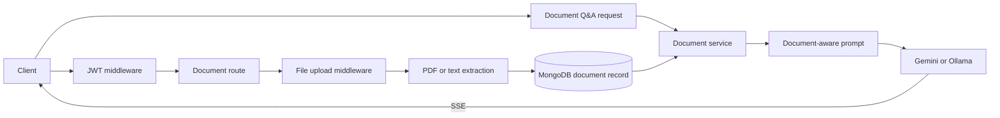

# Day-07 Folder Summary

## Concept
Day-07 extends authenticated chat with document knowledge. Users upload PDF or text files, the server extracts text, stores document metadata in MongoDB, and places relevant document content into the AI prompt for single-document or multi-document answers.

## Real-world example
A legal or customer-support team can ask questions about internal manuals, policies, contracts, or reports. The AI answers from the organization's uploaded documents rather than relying only on general model knowledge.

## Architecture

**Components:**
- `src/middleware/upload.middleware.js`: Validates and stores uploaded files.
- `src/models/document.model.js`: Stores ownership, metadata, extracted text, and status.
- `src/services/document.service.js`: Extracts text and builds document-aware prompts.
- `src/routes/document.routes.js`: Upload, list, delete, summarize, and query endpoints.
- Existing chat, authentication, model, usage, and streaming components remain in place.

**Communication:** Multer writes the file to disk, the document service extracts text and saves metadata, and later document queries load authorized document content into the prompt. The AI response is streamed back to the client. This is a document-grounded pattern, before introduction of vector search.
