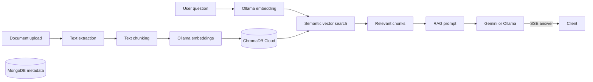

# Day-09 Folder Summary

## Concept
Day-09 adds Retrieval-Augmented Generation (RAG). Documents are split into chunks, converted into numerical embeddings, and stored in a ChromaDB vector collection. At query time, the system finds the most semantically similar chunks and gives them to the AI as evidence.

## Real-world example
A support knowledge base can search thousands of pages and send only the relevant passages to an assistant. This improves answers, makes them traceable to source sections, and avoids loading entire documents into every prompt.

## Architecture

**Components:**
- `src/config/chroma.config.js`: Vector-store connection configuration.
- `src/models/chunk.model.js`: Chunk metadata and vector-store identifiers.
- `src/services/embedding.service.js`: Generates embeddings with Ollama.
- `src/services/vectorstore.service.js`: Indexing and semantic search operations.
- `src/services/rag.service.js`: Coordinates retrieval and AI answer generation.
- `src/routes/rag.routes.js`: Search, index, statistics, and RAG chat APIs.

**Communication:** A document is extracted, split, embedded, and indexed in ChromaDB. A question is embedded and used to retrieve similar chunks. The application combines those chunks with the question and streams a grounded answer. MongoDB remains responsible for application records, while ChromaDB provides similarity search.
