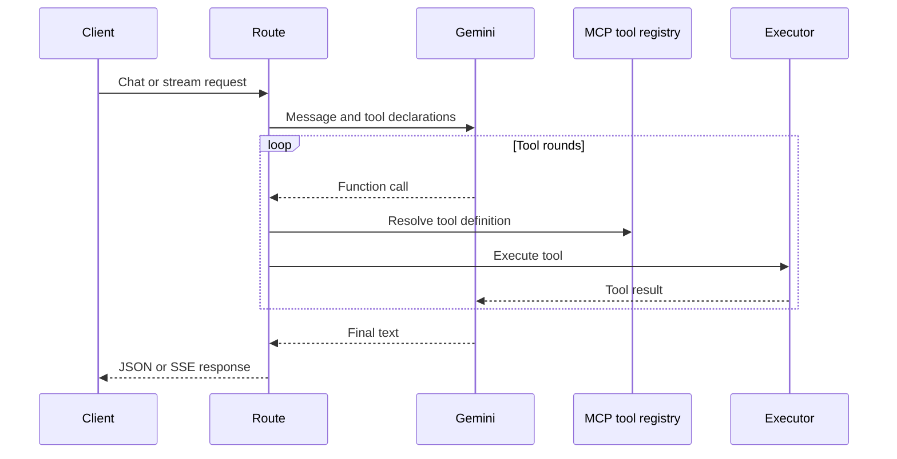

# Day-18 Folder Summary

## Concept
Day-18 introduces tool-using AI agents through the Model Context Protocol (MCP) pattern. An AI model can select registered tools, receive real tool results, and continue until it has enough information to answer.

## Real-world example
An e-commerce support assistant can look up an order, find a customer's orders, check stock, search products, or report weather. It never has to fabricate operational data because tool calls return actual records or service results.

## Architecture

**Components:**
- `src/mcp/tool-registry.js`: Registers tool names, descriptions, parameters, and executors.
- `src/mcp/tool-executor.js`: Dispatches a model-requested tool safely.
- `src/mcp/tools/`: Order, product, and weather tool implementations.
- `src/services/gemini-tools.service.js`: Controls Gemini function-calling rounds and SSE final output.
- `src/routes/agent.routes.js`: Exposes tool discovery, chat, and stream endpoints.

**Communication:** The route sends tool declarations with the prompt. Gemini requests a function by name and arguments. The server resolves the tool, executes it, sends the result back to Gemini, and repeats until Gemini returns final text.
