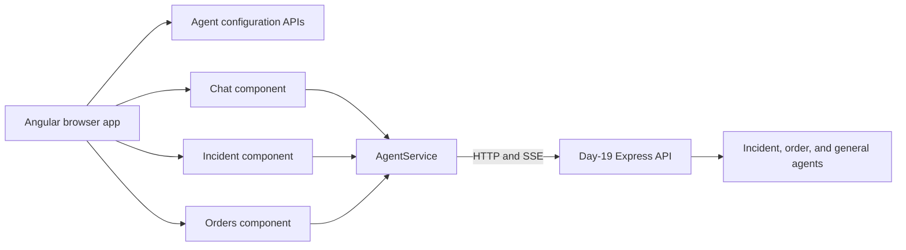

# Day-19 UI Folder Summary

## Concept
Day-19 UI is an Angular 18 frontend for the specialized AI agent backend. It provides chat, incident investigation, order support, provider switching, status updates, tool logs, and approval controls.

## Real-world example
Operations teams can use one browser application to ask an incident agent about service health and approve a controlled restart. Sales or support staff can query orders and products through a conversational interface.

## Architecture

**Components:**
- `src/app/core/services/agent.service.ts`: HTTP calls and native Fetch-based SSE streams.
- `src/app/core/models/agent.models.ts`: Event and message types.
- `src/app/features/chat/`: General conversational UI.
- `src/app/features/incident/`: Incident investigation and approval UI.
- `src/app/features/orders/`: Order-specific interactions.
- `src/app/shared/`: Tool logs and approval-box components.
- `src/app/app.routes.ts`: Client-side routes.

**Communication:** Components call `AgentService`. Normal configuration requests use Angular `HttpClient`; streaming requests use browser Fetch and parse SSE `data:` events. Components update status, tool logs, answer text, and approval controls as events arrive.
