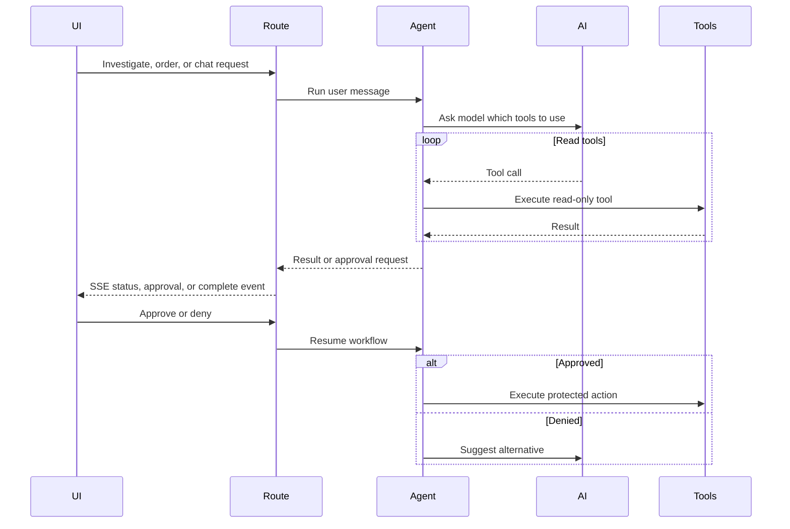

# Day-19 Folder Summary

## Concept
Day-19 advances the tool-using application into specialized agents and human approval workflows. It supports a general agent, an order agent, and an incident agent. Potentially risky operations can pause until the user approves or denies them.

## Real-world example
A DevOps assistant can investigate service health, retrieve logs, or restart a service. Restarting a production service is dangerous, so the system asks an operator for approval before executing it. An order agent can perform similar safe or approval-controlled actions.

## Architecture

**Components:**
- `src/agents/base.agent.js`: Shared provider loop, tool execution, and approval resumption.
- `src/agents/incident.agent.js`: Incident and DevOps investigation specialist.
- `src/agents/order.agent.js`: Order and e-commerce specialist.
- `src/mcp/`: Shared tool definitions and execution registry.
- `src/mcp/tools/devops.tool.js`: Health, logs, restart, and incident tools.
- `src/routes/incident.routes.js`: Investigation, order, pending, and approval endpoints.
- `src/routes/agent.routes.js`: General tool chat and streaming endpoints.
- `src/services/ai-tools.service.js`: Gemini and Ollama tool orchestration.

**Communication:** REST endpoints start an agent workflow. SSE reports provider, status, tool calls, approval requirements, and completion. Pending sessions are stored temporarily in memory, and approval resumes the agent with either an executed action or a denial result.
