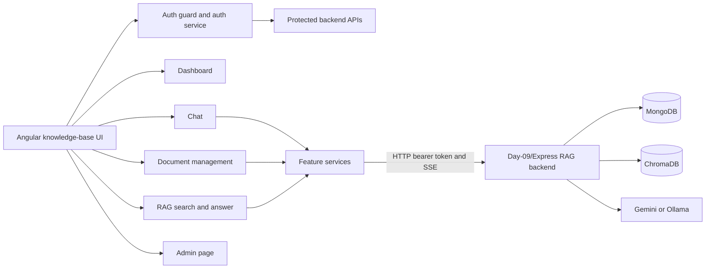

# Knowledge Base UI Folder Summary

## Concept
This Angular application is a complete knowledge-management and document-RAG frontend. It combines authentication, dashboards, conversations, document upload, semantic search, RAG chat, usage views, and administration.

## Real-world example
An organization can provide employees with a private knowledge portal. Employees sign in, upload or browse approved documents, search by meaning rather than exact words, and receive grounded AI answers with source context. Administrators can manage users and platform activity.

## Architecture

**Components:**
- `src/app/core/`: API, authentication, token, loader, guards, and interceptors.
- `src/app/features/auth/`: Login and registration.
- `src/app/features/documents/`: Document upload and management.
- `src/app/features/rag/`: Semantic search and streamed RAG answers.
- `src/app/features/chat/` and `conversations/`: Standard AI chat experience.
- `src/app/features/dashboard/` and `admin/`: Monitoring and administration.
- `src/app/app.routes.ts`: Protected route configuration.

**Communication:** Route guards and interceptors attach authentication state to HTTP requests. Feature services call backend REST and SSE endpoints. The RAG page searches indexed chunks, displays relevant sources, and streams the generated answer. UI libraries include Angular Material, PrimeNG, Bootstrap, and Chart.js for rich presentation.
